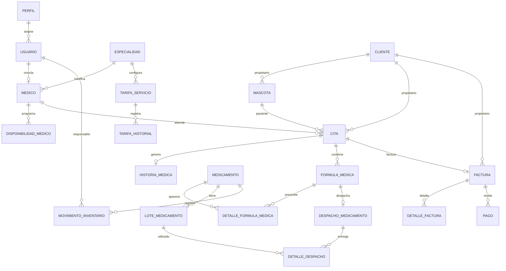

# Modelo de datos propuesto - Examen Final

Archivos fuente:

- Respaldo inicial: [backup-session.sql](../../../backup-session.sql)
- Migración completa: [examen-final-migration.sql](src/main/resources/db/examen-final-migration.sql)
- Ejecución Docker: [docker-compose.yml](../docker-compose.yml)

## Diagrama entidad-relación

## Nucleo clinico

- `usuario` pertenece a un `perfil`; un `medico` puede vincularse a un usuario.
- `medico` pertenece a una especializacion y tiene varias filas en `disponibilidad_medico`.
- `propietario -> mascota -> cita -> medico`: la cita conserva propietario, mascota y profesional.
- `cita -> formula_medica -> detalle_formula_medica -> medicamento`.

## Inventario y despacho

- `medicamento -> lote_medicamento`: permite lotes con precio y vencimiento independientes.
- `formula_medica -> despacho_medicamento -> detalle_despacho -> lote_medicamento`.
- `movimiento_inventario` registra entradas, salidas, ajustes y reversos con usuario y referencia.
- Un movimiento de salida de dispensacion debe relacionarse con formula y despacho.

## Facturacion

- `cita -> factura` tiene unicidad para evitar cobrar dos veces la misma atencion.
- `tarifa_servicio` conserva la configuracion vigente; la factura debe copiar valor e impuestos para conservar el historico.
- Los pagos deben registrarse en una entidad controlada y asociarse a la factura.

## Restricciones principales

- No se permiten cantidades negativas de lote o inventario.
- Medicamentos vencidos no son dispensables.
- La confirmacion de despacho y el descuento se ejecutan en una transaccion.
- Las anulaciones y reversos son trazables; no se eliminan registros historicos.
