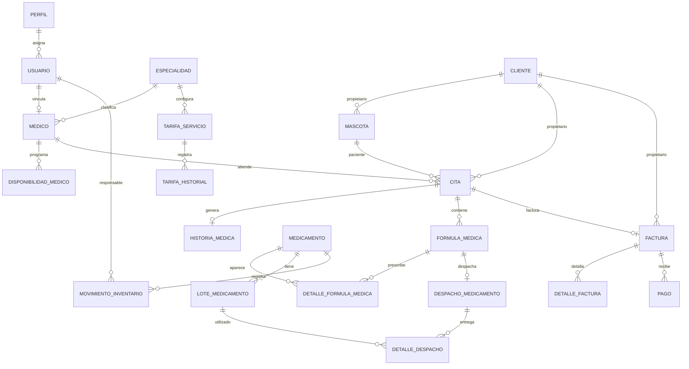

# Modelo entidad-relación actualizado

Este documento corresponde al entregable 1 del examen final.

## Scripts

- Respaldo inicial: [backup-session.sql](../backup-session.sql)
- Migración actualizada: [examen-final-migration.sql](BackendParcialAlmaHernandez/src/main/resources/db/examen-final-migration.sql)
- Ejecución Docker: [docker-compose.yml](docker-compose.yml)

## Diagrama

## Restricciones

- `perfil_menu` evita permisos duplicados mediante clave única.
- `usuario.username` es único.
- `medicamento.codigo` y `nombre` son únicos.
- `lote_medicamento` impide repetir el mismo lote por medicamento.
- `cantidad_actual` y `stock_minimo` no pueden ser negativos.
- `cita.fecha_fin` debe ser posterior a `cita.fecha_hora`.
- Una mascota y un médico no pueden tener citas simultáneas según validación del backend.
- `detalles_formula` impide dispensar una cantidad superior a la prescrita.
- `despacho_medicamento.formula_id` es único para evitar doble descuento.
- `movimiento_inventario` conserva usuario, lote, referencia y estado resultante.
- `factura.cita_id` es único para impedir facturar dos veces el mismo servicio.
