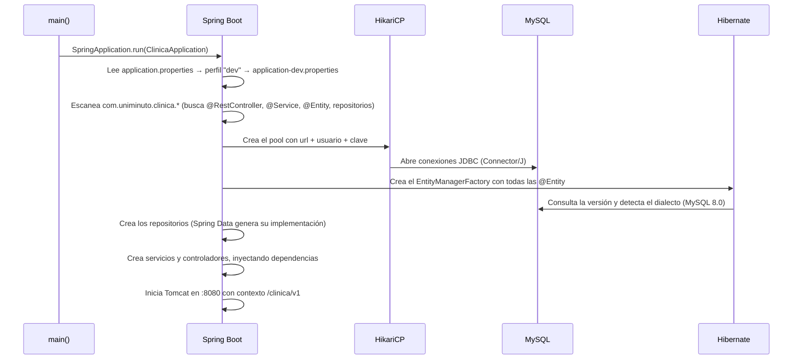
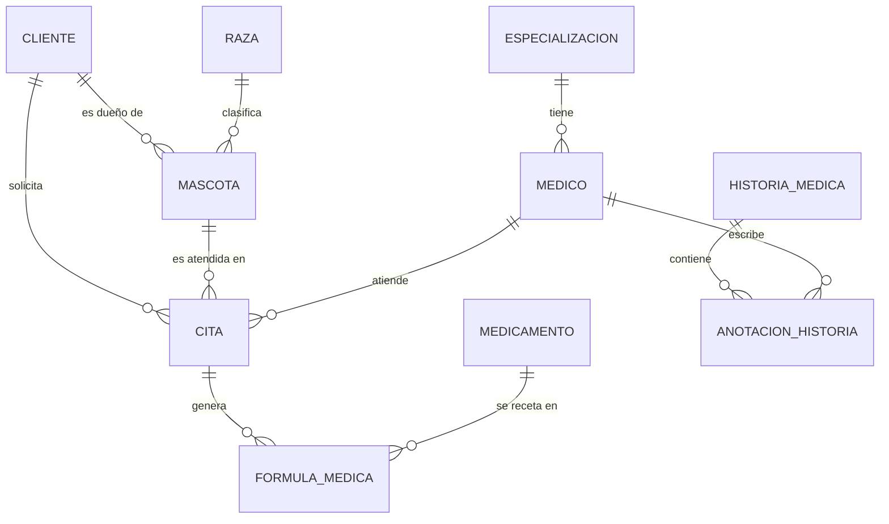
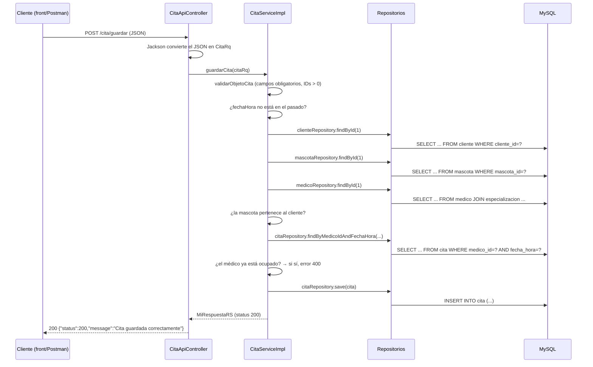

# Documentación técnica — Clínica Veterinaria

Backend REST en **Spring Boot** + base de datos **MySQL**, con un panel web (front) que lo consume.
Este documento explica **cómo está construido por dentro** y **cómo se comunican el código y la base de datos**, paso a paso.

## Contenido
1. [Tecnologías y versiones](#1-tecnologías-y-versiones)
2. [Estructura del proyecto](#2-estructura-del-proyecto)
3. [Arquitectura por capas](#3-arquitectura-por-capas)
4. [Arranque: cómo se conecta a la base de datos](#4-arranque-cómo-se-conecta-a-la-base-de-datos)
5. [Modelo de datos y mapeo tabla ↔ entidad](#5-modelo-de-datos-y-mapeo-tabla--entidad)
6. [Repositorios: de un método Java a una consulta SQL](#6-repositorios-de-un-método-java-a-una-consulta-sql)
7. [Recorrido completo de una petición](#7-recorrido-completo-de-una-petición)
8. [DTO: los objetos que entran y salen](#8-dto-los-objetos-que-entran-y-salen)
9. [Reglas de negocio por servicio](#9-reglas-de-negocio-por-servicio)
10. [Manejo de errores](#10-manejo-de-errores)
11. [Referencia de endpoints](#11-referencia-de-endpoints)
12. [Cómo se comunica el front con el back](#12-cómo-se-comunica-el-front-con-el-back)
13. [Limitaciones conocidas y mejoras](#13-limitaciones-conocidas-y-mejoras)
14. [Preguntas probables en la sustentación](#14-preguntas-probables-en-la-sustentación)
15. [Cómo ejecutar y probar](#15-cómo-ejecutar-y-probar)

---

## 1. Tecnologías y versiones

| Pieza | Tecnología | Para qué sirve |
|---|---|---|
| Lenguaje | Java 21 | Lenguaje del backend |
| Framework | Spring Boot 4.0.4 (Spring MVC 7) | Servidor web, inyección de dependencias, configuración |
| Servidor web | Tomcat 11 (embebido) | Recibe las peticiones HTTP en el puerto 8080 |
| Acceso a datos | Spring Data JPA 4 + Hibernate 7 | Convierte objetos Java en filas SQL y viceversa |
| Pool de conexiones | HikariCP 7 | Mantiene conexiones abiertas a MySQL y las reutiliza |
| Driver | MySQL Connector/J 9.6 | Habla el protocolo de MySQL |
| Base de datos | MySQL 8.0 (esquema `clinica`) | Almacena la información |
| JSON | Jackson 3 | Convierte JSON ↔ objetos Java |
| Utilidad | Lombok | Genera getters y setters en compilación |
| Build | Maven (`mvnw`) | Compila, prueba y empaqueta el `.jar` |
| Front | HTML + CSS + JavaScript puro | Panel web que consume la API |

---

## 2. Estructura del proyecto

```
backend-83680/
├── pom.xml                                  Dependencias y build (Maven)
├── docs/DOCUMENTACION_TECNICA.md            Este documento
└── src/main/
    ├── resources/
    │   ├── application.properties           Elige el perfil activo (dev)
    │   ├── application-dev.properties       Conexión a la BD y puerto (desarrollo)
    │   └── application-prod.properties      Ídem para producción
    └── java/com/uniminuto/clinica/
        ├── ClinicaApplication.java          Punto de entrada (main)
        ├── api/                 (8)  Interfaces: definen RUTAS y verbos HTTP
        ├── apicontroller/       (8)  Controladores: implementan las interfaces api
        ├── service/             (8)  Interfaces de la lógica de negocio
        ├── serviceimpl/         (8)  Implementación de la lógica de negocio
        ├── repository/          (9)  Interfaces de acceso a datos (Spring Data)
        ├── entity/             (10)  Clases que representan tablas
        ├── models/              (8)  DTO: objetos de entrada (Rq) y salida (Rs)
        └── exception/                BadRequestException + manejador global de errores
```

Convención de nombres: `XxxApi` (rutas) → `XxxApiController` (controlador) → `XxxService` / `XxxServiceImpl` (negocio) → `XxxRepository` (datos) → `Xxx` (entidad). Los DTO terminan en `Rq` (request, lo que llega) o `Rs` (response, lo que sale).

Recursos del negocio: **Mascota, Raza, Medico, Medicamento** (existentes) y los del parcial: **FormulaMedica, Cita, AnotacionHistoria** (+ `HistoriaMedica`, de la que depende la anotación).

---

## 3. Arquitectura por capas

Cada capa tiene **una sola responsabilidad** y solo habla con la capa inmediatamente inferior:

```
   Navegador / Postman
          │  HTTP + JSON
          ▼
 ┌───────────────────────┐
 │ api  +  apicontroller │  Recibe la petición, convierte JSON ↔ objetos, devuelve la respuesta.
 └──────────┬────────────┘  NO tiene lógica de negocio.
            ▼
 ┌───────────────────────┐
 │ service / serviceimpl │  Reglas de negocio: valida, decide, coordina varios repositorios,
 └──────────┬────────────┘  convierte entidades en DTO.
            ▼
 ┌───────────────────────┐
 │      repository       │  Único lugar que "habla" con la base de datos (consultas).
 └──────────┬────────────┘
            ▼
 ┌───────────────────────┐
 │        entity         │  Cada clase = una tabla; cada atributo = una columna.
 └──────────┬────────────┘
            ▼
         MySQL (clinica)
```

| Capa | Clase de ejemplo | Qué hace | Qué NO hace |
|---|---|---|---|
| **api** | `CitaApi` | Declara `@RequestMapping("/cita")`, `@GetMapping("/listar")`, parámetros y tipos de entrada/salida. Es el "contrato" del servicio. | No ejecuta nada |
| **apicontroller** | `CitaApiController` | `@RestController`. Implementa la interfaz y delega en el servicio: `return ResponseEntity.ok(citaService.listarCitasPorFechas(...))` | No valida ni consulta la BD |
| **service** | `CitaService` | Interfaz: qué operaciones de negocio existen | — |
| **serviceimpl** | `CitaServiceImpl` | `@Service`. Valida, aplica reglas, llama a repositorios, arma la respuesta | No conoce HTTP ni JSON |
| **repository** | `CitaRepository` | Consultas a la BD | No tiene reglas de negocio |
| **entity** | `Cita` | Mapea la tabla `cita` | — |
| **models** | `CitaRq`, `CitaRs` | Forma exacta de los datos que entran y salen | — |

**Inyección de dependencias.** Las clases no crean a sus colaboradores con `new`; los declaran con `@Autowired` y Spring los entrega ya construidos:

```java
@Service
public class CitaServiceImpl implements CitaService {

    @Autowired
    private CitaRepository citaRepository;      // Spring asigna aquí un objeto que implementa esta interfaz

    @Autowired
    private ClienteRepository clienteRepository;
    ...
}
```

`CitaApiController` declara un `CitaService`; como solo existe una clase `@Service` que lo implementa (`CitaServiceImpl`), Spring sabe cuál entregar.

---

## 4. Arranque: cómo se conecta a la base de datos

### 4.1 Archivos de configuración

`application.properties` solo elige el perfil:
```properties
spring.profiles.active=dev          # → además se lee application-dev.properties
```

`application-dev.properties`, línea por línea:

| Propiedad | Significado |
|---|---|
| `server.port=8080` | Tomcat escucha en el puerto 8080 |
| `server.servlet.context-path=/clinica/v1` | Prefijo de **todas** las rutas → `http://localhost:8080/clinica/v1/...` |
| `server.tomcat.threads.max=32` | Máximo de hilos atendiendo peticiones a la vez |
| `spring.datasource.driver-class-name=com.mysql.cj.jdbc.Driver` | Clase del driver JDBC de MySQL |
| `spring.datasource.url=jdbc:mysql://localhost:3306/clinica?...` | **Dirección de la BD**: servidor `localhost`, puerto `3306`, esquema `clinica` |
| `spring.datasource.username` / `password` | Usuario y clave de MySQL |
| `spring.jpa.show-sql=true` | Imprime en consola cada SQL que se ejecuta (útil para explicar) |

Parámetros de la URL (después del `?`):
- `serverTimezone=America/Bogota` → zona horaria con que el driver interpreta las columnas `datetime`.
- `useSSL=false` → conexión sin cifrar (es local).
- `zeroDateTimeBehavior=round` → cómo tratar fechas `0000-00-00`.

> No existe `spring.jpa.hibernate.ddl-auto`, por lo que Hibernate **no crea ni modifica tablas**. El esquema se administra a mano en MySQL Workbench; el código solo lee y escribe datos.

### 4.2 Secuencia de arranque



Si la BD está apagada o la clave es incorrecta, la aplicación **no arranca**, porque Hibernate necesita conectarse en ese momento para leer la versión de MySQL.

### 4.3 Quién hace qué en la comunicación con MySQL

```
Tu código Java ── llama ──▶ Repository (Spring Data)
                              │ traduce a
                              ▼
                          Hibernate (JPA): construye el SQL desde las anotaciones de la entidad
                              │ pide una conexión a
                              ▼
                          HikariCP (pool)
                              │ usa
                              ▼
                          MySQL Connector/J (driver JDBC)  ──TCP 3306──▶  MySQL
```

---

## 5. Modelo de datos y mapeo tabla ↔ entidad

### 5.1 Diagrama de relaciones



### 5.2 Tablas del parcial (columna por columna)

**`cita`** → entidad `Cita`

| Columna | Tipo MySQL | Atributo Java | Anotación |
|---|---|---|---|
| `id` | bigint AUTO_INCREMENT (PK) | `Long id` | `@Id @GeneratedValue(IDENTITY)` |
| `cliente_id` | int | `Cliente cliente` | `@ManyToOne @JoinColumn(name="cliente_id")` |
| `mascota_id` | int | `Mascota mascota` | `@ManyToOne @JoinColumn(name="mascota_id")` |
| `medico_id` | int | `Medico medico` | `@ManyToOne @JoinColumn(name="medico_id")` |
| `fecha_hora` | datetime | `LocalDateTime fechaHora` | `@Column` |
| `estado` | varchar(20) | `String estado` | `@Column` |
| `motivo` | text | `String motivo` | `@Column(columnDefinition="TEXT")` |

**`formula_medica`** → `FormulaMedica`: `id`, `cita_id` → `Cita cita`, `medicamento_id` → `Medicamento medicamento`, `dosis`, `indicaciones`, `fecha_creacion_registro`, `fecha_actualizacion_registro`.

**`historia_medica`** → `HistoriaMedica`: `id`, `paciente_id` (`Integer`, sin relación), `fecha_creacion`.

**`anotacion_historia`** → `AnotacionHistoria`: `id`, `historia_id` → `HistoriaMedica historia`, `medico_id` → `Medico medico`, `fecha`, `descripcion`.

Las demás (`cliente`, `mascota`, `raza`, `medico`, `especializacion`, `medicamento`) siguen el mismo patrón. Las tablas `usuario` y `session` existen en la BD pero **no se usan** en este proyecto.

### 5.3 Cómo se lee una entidad

```java
@Entity                         // "esta clase representa una tabla"
@Table(name = "cita")           // ...que se llama cita
@Data                           // Lombok: getters, setters, equals, hashCode, toString
public class Cita {

    @Id                                                    // clave primaria
    @GeneratedValue(strategy = GenerationType.IDENTITY)    // la genera MySQL (AUTO_INCREMENT)
    @Column(name = "id")
    private Long id;

    @ManyToOne                                             // muchas citas → un cliente
    @JoinColumn(name = "cliente_id", nullable = false)     // columna FK en la tabla cita
    private Cliente cliente;                               // ¡objeto completo, no solo el número!
    ...
}
```

Con `@ManyToOne`, Hibernate carga el **objeto** relacionado (`cita.getCliente().getNombres()`) haciendo la consulta necesaria por sí mismo. Con `@GeneratedValue(IDENTITY)`, al hacer `save()` de un objeto nuevo Hibernate omite el `id` en el `INSERT` y luego lee el que asignó MySQL.

### 5.4 Importante: la BD no tiene claves foráneas

Al inspeccionar el esquema se comprobó que **ninguna tabla declara `FOREIGN KEY`**. Las relaciones existen solo en la lógica de la aplicación. Consecuencia: **MySQL no impide** guardar una cita con un `cliente_id` inexistente. Por eso los servicios buscan cada entidad con `findById` **antes** de guardar y lanzan un error si no existe: esa es la garantía de integridad.

---

## 6. Repositorios: de un método Java a una consulta SQL

Un repositorio es solo una **interfaz**; Spring Data crea la implementación en tiempo de ejecución:

```java
public interface CitaRepository extends JpaRepository<Cita, Long> { ... }
//                                       └ entidad ┘ └ tipo del id ┘
```

`JpaRepository` ya trae, sin escribir nada: `findAll()`, `findById(id)`, `save(entidad)`, `deleteById(id)`, `count()`, etc.

Además se declaran **consultas por el nombre del método**: Spring Data "lee" el nombre y arma la consulta.

| Método declarado | Cómo se lee |
|---|---|
| `findAllByOrderByFechaCreacionRegistroDesc()` | *todas*, ordenadas por `fechaCreacionRegistro` descendente |
| `findByFechaHoraBetweenOrderByFechaHoraDesc(inicio, fin)` | las que tengan `fechaHora` *entre* `inicio` y `fin`, ordenadas por `fechaHora` descendente |
| `findByFechaBetweenOrderByFechaDesc(inicio, fin)` | ídem para anotaciones (atributo `fecha`) |
| `findByMedicoIdAndFechaHora(medicoId, fechaHora)` | las citas cuyo `medico.id` y `fechaHora` coincidan |
| `existsByNombreAndEspecie(nombre, especie)` | ¿existe una raza con ese nombre y esa especie? |

### 6.1 SQL real que ejecuta cada operación

(Capturado de la consola con `show-sql=true`.)

| Operación | Método | SQL generado |
|---|---|---|
| Listar fórmulas | `findAllByOrderByFechaCreacionRegistroDesc()` | `select ... from formula_medica fm1_0 order by fm1_0.fecha_creacion_registro desc` |
| Listar citas por fechas | `findByFechaHoraBetweenOrderByFechaHoraDesc(...)` | `select ... from cita c1_0 where c1_0.fecha_hora between ? and ? order by c1_0.fecha_hora desc` |
| Listar anotaciones | `findByFechaBetweenOrderByFechaDesc(...)` | `select ... from anotacion_historia ah1_0 where ah1_0.fecha between ? and ? order by ah1_0.fecha desc` |
| ¿Médico ocupado? | `findByMedicoIdAndFechaHora(...)` | `select ... from cita c1_0 where c1_0.medico_id=? and c1_0.fecha_hora=?` |
| Crear cita | `save(citaNueva)` (id = null) | `insert into cita (cliente_id,estado,fecha_hora,mascota_id,medico_id,motivo) values (?,?,?,?,?,?)` |
| Actualizar cita | `save(citaExistente)` (id ≠ null) | `update cita set cliente_id=?,estado=?,fecha_hora=?,mascota_id=?,medico_id=?,motivo=? where id=?` |
| Crear anotación | `save(anotacionNueva)` | `insert into anotacion_historia (descripcion,fecha,historia_id,medico_id) values (?,?,?,?)` |
| Actualizar anotación | `save(anotacionExistente)` | `update anotacion_historia set descripcion=?,fecha=?,historia_id=?,medico_id=? where id=?` |
| Buscar por id | `findById(id)` | `select ... from cliente where cliente_id=?` (y equivalentes) |

Los `?` son **parámetros enlazados** (`PreparedStatement`): los valores nunca se concatenan al texto SQL, lo que evita inyección SQL.

**`save()` decide solo entre INSERT y UPDATE:** si el objeto tiene `id == null` es nuevo → `INSERT`; si tiene id → `UPDATE` de todas sus columnas.

---

## 7. Recorrido completo de una petición

### 7.1 Lectura — `GET /cita/listar?fechaInicial=2024-01-01&fechaFinal=2026-12-31`

1. **Tomcat** recibe la petición HTTP, quita el prefijo `/clinica/v1` y la entrega al `DispatcherServlet` de Spring MVC.
2. Spring busca qué método atiende `GET /cita/listar`: lo encuentra en la interfaz `CitaApi` (`@RequestMapping("/cita")` + `@GetMapping("/listar")`), implementada por `CitaApiController`.
3. **Conversión de parámetros:** `@RequestParam @DateTimeFormat(iso = ISO.DATE) LocalDate` convierte el texto `"2024-01-01"` en un `LocalDate`. Si el formato es inválido, Spring lanza `MethodArgumentTypeMismatchException` (→ HTTP 400).
4. `CitaApiController.listarCitasPorFechas(...)` llama a `citaService.listarCitasPorFechas(...)`.
5. `CitaServiceImpl` (Pasos 1 a 4 del código):
   - **Paso 1:** valida que las dos fechas existan y que la inicial no sea mayor que la final (si no, `BadRequestException` → 400).
   - **Paso 2:** convierte las fechas en un rango de fecha y hora: `2024-01-01 00:00:00` hasta `2026-12-31 23:59:59`.
   - **Paso 3:** llama a `citaRepository.findByFechaHoraBetweenOrderByFechaHoraDesc(inicio, fin)`.
   - **Paso 4:** recorre las citas con un `for` y arma un `CitaRs` por cada una.
6. Hibernate arma el SQL, HikariCP presta una conexión, Connector/J lo envía a MySQL.
7. MySQL devuelve filas; Hibernate crea objetos `Cita` (y carga su `Cliente`, `Mascota`, `Medico`).
8. El controlador devuelve `ResponseEntity.ok(lista)`; **Jackson** serializa la lista a JSON.

**¿Por qué el fin es a las 23:59:59?** El usuario escribe fechas (sin hora). Una cita del 31/12 a las 14:00 debe entrar en un rango que termina el 31/12; si el fin fuera `2026-12-31` (las 00:00) se perdería. Por eso el inicio es `atStartOfDay()` (00:00:00) y el fin es `atTime(23, 59, 59)`, con lo que el último día queda completo.

### 7.2 Escritura — `POST /cita/guardar`

Cuerpo enviado:
```json
{ "clienteId": 1, "mascotaId": 1, "medicoId": 1,
  "fechaHora": "2027-01-15T10:00:00", "motivo": "Vacunacion" }
```



Si cualquier validación falla, el servicio lanza `BadRequestException`. Al ser una excepción sin `throws` obligatorio (`RuntimeException`), **sube sola** por el controlador hasta el `GlobalExceptionHandler`, que responde `400` con `{"status":400,"error":"BAD REQUEST","message":"..."}`. **No se llega a ejecutar el `INSERT`.**

### 7.3 Actualización — `POST /cita/actualizar`

Igual que crear, con estas diferencias: exige `citaId` y `estado` (uno de `programada`, `completada`, `cancelada`); busca la cita existente con `findById`; no exige que la fecha sea futura (se puede completar una cita pasada); si el estado es `cancelada` **no** revisa la disponibilidad del médico; al revisar disponibilidad **ignora la propia cita** para no chocar consigo misma; termina con `save()`, que como el objeto ya tiene id genera un `UPDATE`.

(Se usa `POST` también para actualizar, igual que el servicio `/mascota/actualizar` que ya existía en el proyecto.)

---

## 8. DTO: los objetos que entran y salen

La entidad `Cita` contiene objetos anidados (`Cliente`, `Mascota`, `Medico`, con datos personales). Para los servicios nuevos **no se devuelve la entidad directamente**; se usan DTO:

| Tipo | Ejemplo | Dirección | Contenido |
|---|---|---|---|
| **Rq** (request) | `CitaRq` | Cliente → Servidor | Solo IDs planos: `clienteId`, `mascotaId`, `medicoId`, `fechaHora`, `estado`, `motivo` |
| **Rs** (response) | `CitaRs` | Servidor → Cliente | Datos ya "aplanados": `clienteNombre`, `mascotaNombre`, `medicoNombre`, etc. |
| **MiRespuestaRS** | — | Servidor → Cliente | `{status, message}` tras guardar o actualizar |

Ventajas: se controla exactamente qué datos se exponen, y si cambia la tabla no cambia necesariamente el contrato con el cliente.

La conversión entidad → DTO se hace en el servicio, con un `for` que copia los datos:
```java
List<CitaRs> respuesta = new ArrayList<>();
for (Cita cita : citas) {
    CitaRs rs = new CitaRs();
    rs.setId(cita.getId());
    rs.setClienteNombre(cita.getCliente().getNombres() + " " + cita.getCliente().getApellidos());
    ...
    respuesta.add(rs);
}
```

Los servicios que ya existían (mascotas, médicos, medicamentos) siguen devolviendo la entidad, como estaban.

---

## 9. Reglas de negocio por servicio

### Fórmulas médicas — `FormulaMedicaServiceImpl`
- Lista todas ordenadas por `fecha_creacion_registro` **descendente** (más reciente primero). El orden lo hace **MySQL** (`ORDER BY`), no Java.

### Citas — `CitaServiceImpl`
| Regla | Aplica en | Mensaje de error |
|---|---|---|
| Rango de fechas obligatorio y coherente | listar | "La fecha inicial y la fecha final son obligatorias" / "La fecha inicial no puede ser mayor que la fecha final" |
| `clienteId`, `mascotaId`, `medicoId` > 0 y `fechaHora` presente | guardar y actualizar | "El ID del … no puede ser nulo o menor que 1" |
| La cita nueva no puede estar en el pasado | guardar | "La fecha y hora de la cita no puede estar en el pasado" |
| Cliente, mascota y médico deben existir | guardar y actualizar | "Cliente no encontrado", "Mascota no encontrada", "Médico no encontrado" |
| La mascota debe pertenecer al cliente | guardar y actualizar | "La mascota no pertenece al cliente" |
| El médico no puede tener 2 citas activas a la misma hora | guardar y actualizar | "El médico ya tiene una cita a esa fecha y hora" |
| Estado válido | actualizar | "El estado debe ser programada, completada o cancelada" |
| `citaId` obligatorio y existente | actualizar | "El ID de la cita no puede ser nulo" / "Cita no encontrada" |
| Toda cita nueva nace `programada` | guardar | (se ignora el estado enviado) |

### Anotaciones de historia — `AnotacionHistoriaServiceImpl`
- **Guardar:** exige `historiaId` existente, `medicoId` existente y `descripcion` no vacía; asigna `fecha = ahora`.
- **Actualizar:** exige `anotacionId` existente; cambia médico y descripción. **No** cambia la historia ni la fecha original.
- **Listar:** rango de fechas obligatorio; orden descendente por fecha.

### Mascotas y razas (existentes)
- Mascota: valida nombre, edad ≥ 0, IDs; guardar y actualizar buscan cliente y raza antes de escribir.
- Raza: no permite repetir el par **(nombre, especie)**. (Antes rechazaba cualquier segunda raza de una misma especie.)

---

## 10. Manejo de errores

Todo error llega al cliente con el mismo formato:
```json
{ "status": 400, "error": "BAD REQUEST", "message": "El médico ya tiene una cita a esa fecha y hora" }
```

`GlobalExceptionHandler` (`@RestControllerAdvice`) intercepta las excepciones de **cualquier** controlador:

| Excepción | HTTP | Cuándo ocurre |
|---|---|---|
| `BadRequestException` (propia) | 400 | Falla una regla de negocio o validación en un servicio |
| `HttpMessageNotReadableException` | 400 | JSON mal formado, cuerpo vacío o fecha con formato inválido |
| `MethodArgumentTypeMismatchException` | 400 | Parámetro de URL con formato inválido (`fechaInicial=abc`) |
| `MissingServletRequestParameterException` | 400 | Falta un parámetro obligatorio de la URL |
| `Exception` (cualquier otra) | 500 | Error no previsto (por ejemplo, la BD se cayó) |

`BadRequestException` extiende `RuntimeException`: no obliga a declarar `throws` en cada método y viaja sola hasta el manejador. (Antes el código importaba por error `org.apache.coyote.BadRequestException`, de Tomcat; el manejador nunca se activaba y los errores salían como 500.)

---

## 11. Referencia de endpoints

Base: `http://localhost:8080/clinica/v1`

| Método | Ruta | Entrada | Salida |
|---|---|---|---|
| GET | `/formula-medica/listar` | — | `[FormulaMedicaRs]` |
| GET | `/cita/listar` | `fechaInicial`, `fechaFinal` (yyyy-MM-dd) | `[CitaRs]` |
| POST | `/cita/guardar` | `CitaRq` | `MiRespuestaRS` |
| POST | `/cita/actualizar` | `CitaRq` (con `citaId` y `estado`) | `MiRespuestaRS` |
| GET | `/anotacion-historia/listar` | `fechaInicial`, `fechaFinal` | `[AnotacionHistoriaRs]` |
| POST | `/anotacion-historia/guardar` | `AnotacionHistoriaRq` (con `historiaId`) | `MiRespuestaRS` |
| POST | `/anotacion-historia/actualizar` | `AnotacionHistoriaRq` (con `anotacionId`) | `MiRespuestaRS` |
| GET | `/mascota/listar`, `/listar-by-cliente?clienteId=`, `/listar-by-raza?razaId=` | — | `[Mascota]` |
| POST | `/mascota/guardar`, `/mascota/actualizar` | `MascotaRq` | `MiRespuestaRS` |
| POST | `/raza/guardar` | `RazaRq` | `MiRespuestaRS` |
| GET | `/medico/listar`, `/medicamento/listar` | — | `[Medico]`, `[Medicamento]` |
| GET | `/clinica/test`, `/test2`, `/test3` | — | Pruebas de que el servicio vive |

Ejemplo de respuesta de `GET /cita/listar`:
```json
[{ "id": 1, "clienteId": 1, "clienteNombre": "Juan Pérez López",
   "mascotaId": 1, "mascotaNombre": "Max",
   "medicoId": 3, "medicoNombre": "Carlos Martínez Ruiz",
   "fechaHora": "2025-10-16T21:30:00", "estado": "programada", "motivo": "Consulta general" }]
```

---

## 12. Cómo se comunica el front con el back

El front está en la carpeta aparte `frontend-83680/` (tres archivos: `index.html`, `styles.css`, `app.js`). **No habla nunca con la base de datos**; solo llama a la API REST del backend, y el backend es el único que toca MySQL.

```
 Navegador (app.js)  ──fetch (HTTP+JSON)──▶  Backend Spring  ──JDBC──▶  MySQL
        ◀────────── JSON ─────────────────        ◀──── filas ────
```

- **Función central `api(ruta, {metodo, cuerpo})`** en `app.js`: hace `fetch(baseApi + ruta, ...)`, envía el cuerpo como JSON con `Content-Type: application/json` y devuelve el JSON de respuesta. Si el backend responde con error, toma el campo `message` del `ErrorResponse` y lo muestra al usuario.
- **CORS:** el front se abre desde otro origen (`localhost:5173` o `file://`) y el back está en `:8080`. Los navegadores bloquean por defecto esa llamada; el backend la permite con `@CrossOrigin(origins = "*")` en cada interfaz `Api` (cabecera `Access-Control-Allow-Origin: *`).
- **Flujo de un guardado (ejemplo, crear una cita):**
  1. El usuario llena el diálogo y pulsa *Guardar* → se ejecuta `guardarCita()`.
  2. Arma `{clienteId, mascotaId, medicoId, fechaHora, motivo}` (el cliente sale de la mascota elegida).
  3. `api('/cita/guardar', {metodo:'POST', cuerpo})` → el back valida e inserta (secciones 7.2 y 6.1).
  4. Si responde 200, el front cierra el diálogo, muestra el aviso y vuelve a pedir `GET /cita/listar` para refrescar la tabla **con lo que realmente quedó en la BD**.
  5. Si responde 400, muestra el `message` dentro del diálogo.
- **Selectores:** al iniciar, el front pide `/mascota/listar` y `/medico/listar` para llenar las listas desplegables.
- **Seguridad en pantalla:** todo texto que viene del servidor se pasa por `esc()` antes de insertarlo en HTML, para evitar inyección de código (XSS).

---

## 13. Limitaciones conocidas y mejoras

Conviene conocerlas para responder con honestidad:

1. **Consultas extra (problema "N+1").** Las relaciones `@ManyToOne` se cargan de inmediato (*eager*). Al listar N citas, Hibernate ejecuta 1 consulta de citas **más** consultas adicionales por cada cliente, mascota y médico (se ven en la consola). Con pocos datos no importa. Mejora: `fetch = LAZY` + `JOIN FETCH` o `@EntityGraph`.
2. **Choque de horarios no atómico.** Se verifica la disponibilidad con un `SELECT` y luego se inserta; dos peticiones simultáneas podrían pasar ambas. La solución definitiva es una restricción `UNIQUE` en la BD (médico + fecha_hora).
3. **Sin claves foráneas en la BD** (ver 5.4): la integridad depende del código.
4. **Sin autenticación.** Existen las tablas `usuario` y `session`, pero el proyecto no las usa; CORS está abierto a cualquier origen.
5. **No encontrado = 400.** Se mantuvo el criterio original del proyecto (todo error de negocio es `BadRequestException`). Lo más estricto sería 404 para "no encontrado".
6. **Rutas o verbos inexistentes devuelven 500.** El manejador genérico `Exception` los captura (comportamiento del proyecto original). Lo ideal sería 404/405.
7. **Estados de cita** (`programada`, `completada`, `cancelada`): `completada` y `cancelada` son un supuesto; en la BD solo existía `programada`.
8. **`historia_medica.paciente_id`:** no se sabe si referencia mascota o cliente, por eso se dejó como número sin relación.
9. **Pruebas automáticas:** solo existe `contextLoads` (verifica que la app arranque y conecte a la BD). Los servicios se probaron manualmente con `curl` y con el front.

---

## 14. Preguntas probables en la sustentación

**¿Por qué separar `Api` y `ApiController`?**
La interfaz `Api` define el *contrato* (rutas, verbos, tipos) y el controlador solo lo implementa y delega. Así las rutas quedan documentadas en un lugar y el controlador no mezcla responsabilidades.

**¿Por qué usar interfaces `Service` y `ServiceImpl`?**
Se programa contra la abstracción: el controlador depende de `CitaService`, no de la clase concreta. Facilita cambiar la implementación o sustituirla por un objeto simulado en pruebas.

**¿Qué hace `@Autowired`?**
Le pide a Spring que entregue un objeto ya construido en ese campo (inyección de dependencias). Así las clases no crean sus colaboradores con `new`.

**¿Quién implementa `CitaRepository` si es una interfaz?**
Spring Data JPA genera una implementación en tiempo de ejecución al arrancar, a partir de `JpaRepository` y de los nombres de los métodos declarados.

**¿Cómo pasa Java a SQL?**
Hibernate lee las anotaciones de las entidades (`@Entity`, `@Table`, `@Column`, `@JoinColumn`) y con ellas construye el SQL. Se puede ver en la consola porque `show-sql=true`.

**¿Qué diferencia hay entre entidad y DTO?**
La entidad refleja la tabla; el DTO refleja lo que se quiere mostrar o recibir. Se separan para no exponer datos internos y para no depender de la estructura de la BD.

**¿Qué pasa si la BD está caída?**
Al arrancar, la app no inicia. Si se cae con la app ya corriendo, la petición falla y el manejador global responde `500`.

**¿Por qué `RuntimeException` y no una excepción comprobada?**
Evita repetir `throws` en cada capa, y permite que suba directamente al `GlobalExceptionHandler`.

**¿Por qué el orden se hace en la consulta y no en Java?**
Porque MySQL ordena de forma eficiente y el código queda más simple: `OrderByFechaHoraDesc` en el nombre del método en vez de ordenar una lista en memoria.

**¿Qué significa `Between` en `findByFechaHoraBetween...`?**
Spring Data lo traduce a `fecha_hora between ? and ?`, que incluye los dos extremos. Por eso el fin del rango se arma con las 23:59:59 del último día.

**¿Qué es el `?` en el SQL de la consola?**
Un parámetro enlazado (`PreparedStatement`). El valor viaja separado del texto SQL, lo que evita la inyección SQL.

**¿Cómo evitan que guarden una cita con un cliente inexistente si la BD no tiene claves foráneas?**
El servicio hace `findById` para cada entidad relacionada antes de guardar; si no existe, lanza `BadRequestException` y nunca llega al `INSERT`.

---

## 15. Cómo ejecutar y probar

**Requisitos:** Java 21, MySQL con el esquema `clinica`.

```bash
./mvnw spring-boot:run
# o con el jar ya compilado:
./mvnw clean package && java -jar target/clinica-0.0.1-SNAPSHOT.jar
```

Front: abrir `frontend-83680/index.html` (o `python -m http.server 5173` dentro de esa carpeta).

**Pruebas rápidas con `curl`:**
```bash
B=http://localhost:8080/clinica/v1

# 1. Fórmulas (más reciente primero)
curl $B/formula-medica/listar

# 2. Citas en un rango
curl "$B/cita/listar?fechaInicial=2024-01-01&fechaFinal=2026-12-31"

# 3. Guardar cita
curl -X POST $B/cita/guardar -H "Content-Type: application/json" \
  -d '{"clienteId":1,"mascotaId":1,"medicoId":1,"fechaHora":"2027-01-15T10:00:00","motivo":"Vacunacion"}'

# 4. Actualizar cita (cambiar estado; reemplazar 5 por el id de la cita que se quiera editar)
curl -X POST $B/cita/actualizar -H "Content-Type: application/json" \
  -d '{"citaId":5,"clienteId":1,"mascotaId":1,"medicoId":1,"fechaHora":"2027-01-15T10:00:00","estado":"completada"}'

# 5. Anotaciones
curl -X POST $B/anotacion-historia/guardar -H "Content-Type: application/json" \
  -d '{"historiaId":1,"medicoId":1,"descripcion":"Paciente estable"}'
curl "$B/anotacion-historia/listar?fechaInicial=2026-01-01&fechaFinal=2026-12-31"

# 6. Un error controlado (rango invertido) → 400
curl "$B/cita/listar?fechaInicial=2026-12-31&fechaFinal=2024-01-01"
```

Para ver el SQL que se ejecuta, basta mirar la consola donde corre el backend (líneas que empiezan por `Hibernate:`), o consultar el resultado en MySQL Workbench: `SELECT * FROM cita ORDER BY id DESC;`.

---

## 15. Segundo parcial: citas, historias clínicas y fórmulas

### 15.1 Cambios en la base de datos
Script: `docs/script_parcial2.sql` (solo agrega columnas).
- `historia_medica`: `paciente_id` ahora es la **mascota**; se agregan `cita_id`, `medico_id`, `fecha_hora`, `motivo`, `diagnostico`, `observaciones`.
- `anotacion_historia`: se agregan `observacion` y `diagnostico`.
- `formula_medica`: se agregan `medico_id`, `frecuencia`, `duracion_dias`, `fecha_emision` y `activo`.
- `cita`: el estado `completada` pasa a llamarse `atendida`.

### 15.2 Endpoints nuevos o cambiados
| Método | Ruta | Para qué |
|---|---|---|
| GET | `/cliente/listar` | Listar clientes |
| GET | `/cliente/consultar?clienteId=` | Consultar un cliente |
| POST | `/cliente/guardar` | Crear cliente (documento único, mayor de edad) |
| PUT | `/cliente/actualizar` | Editar cliente |
| POST | `/medico/guardar` | Crear médico (documento y registro únicos) |
| PUT | `/medico/actualizar` | Editar médico |
| GET | `/especializacion/listar` | Listar especializaciones |
| GET | `/raza/listar` | Listar razas |
| GET | `/mascota/listar-by-cliente?clienteId=` | Mascotas de un cliente |
| GET | `/mascota/consultar?mascotaId=` | Consultar una mascota |
| GET | `/medico/listar` | Listar veterinarios |
| GET | `/cita/listar` (fechas opcionales) | Listar citas |
| GET | `/cita/listar-by-mascota?mascotaId=` | Citas de una mascota |
| GET | `/cita/consultar?citaId=` | Consultar una cita |
| POST | `/cita/guardar` | Crear cita |
| PUT | `/cita/actualizar` | Editar cita |
| PUT | `/cita/reactivar?citaId=` | Reactivar cita cancelada |
| GET | `/historia-medica/listar` | Listar historias |
| GET | `/historia-medica/consultar?historiaId=` | Consultar historia |
| POST | `/historia-medica/guardar` | Crear historia |
| GET | `/anotacion-historia/listar-by-historia?historiaId=` | Anotaciones de una historia |
| POST | `/anotacion-historia/guardar` | Crear anotación |
| PUT | `/anotacion-historia/actualizar` | Editar anotación |
| GET | `/formula-medica/listar` | Listar fórmulas |
| GET | `/formula-medica/consultar?formulaId=` | Consultar fórmula |
| POST | `/formula-medica/guardar` | Crear fórmula |
| PUT | `/formula-medica/actualizar` | Editar fórmula |
| PATCH | `/formula-medica/inactivar?formulaId=` | Inactivar fórmula |

### 15.3 Reglas de negocio (todas validadas en el backend)
**Citas**
- Cliente, mascota y veterinario deben existir; la mascota debe ser del cliente.
- No se crean citas en el pasado.
- El veterinario no puede tener otra cita 15 minutos antes o después.
- La mascota no puede tener dos citas al mismo tiempo (misma ventana de 15 minutos).
- Estados: pendiente, confirmada, programada, atendida y cancelada. Una cita nueva solo puede ser pendiente, confirmada o programada.
- **Cancelada**: no se puede editar; para usarla otra vez hay que llamar a `reactivar` (operación explícita), que la deja pendiente si la fecha sigue siendo futura y el horario está libre.
- **Atendida**: no se puede editar porque ya es información histórica (con ella se crea la historia clínica).

**Historias clínicas**
- Cliente, mascota, cita y veterinario deben existir; la mascota debe ser del cliente y la cita de esa mascota.
- Solo una cita **atendida** puede generar historia, y una cita solo puede tener una historia.
- Las anotaciones necesitan veterinario, descripción y diagnóstico/evolución.

**Fórmulas médicas**
- La mascota debe existir y tener un cliente; el veterinario debe existir.
- La cita debe ser de esa misma mascota y no estar cancelada.
- La fecha de emisión no puede ser anterior a la fecha de la consulta.
- Dosis y frecuencia son obligatorias; la duración va de 1 a 365 días.
- No se repite el mismo medicamento activo en la misma consulta.
- Las fórmulas **no se borran**: se inactivan (PATCH) y una fórmula inactiva ya no se puede editar.
- Al editar solo se cambia el tratamiento (medicamento, fecha, dosis, frecuencia, duración, indicaciones), no la mascota, la cita ni el veterinario.

### 15.4 Decisiones técnicas
- Las reglas se validan en el backend (`ServiceImpl`) y se repiten en Angular solo para ayudar al usuario.
- Los errores salen como `BadRequestException` con mensajes claros; el error 500 ya no muestra el mensaje técnico.
- En el front, los listados se filtran, ordenan y paginan en el navegador (igual que en Mascotas), y la paginación es un componente reutilizable (`shared/paginacion`).
- Combos dependientes: Cliente → Mascotas del cliente → Citas de la mascota.
